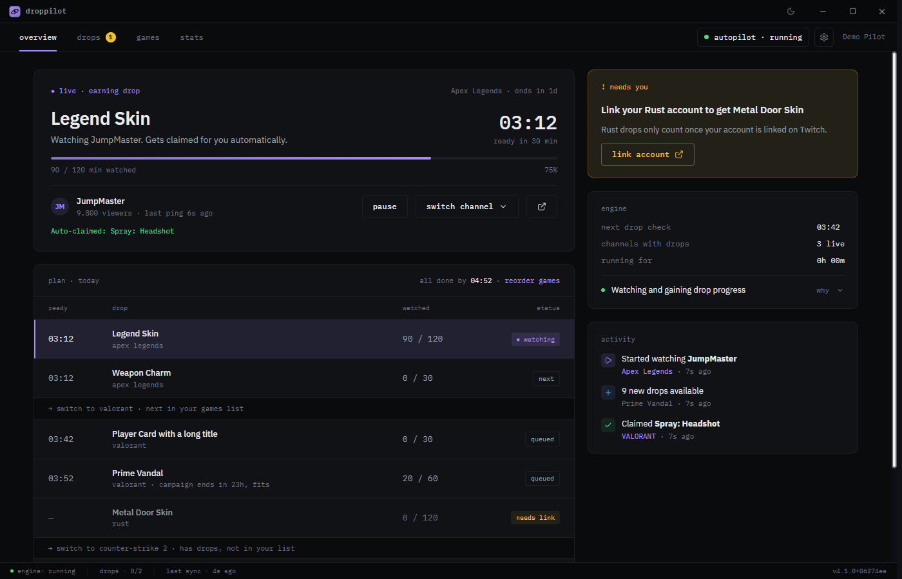
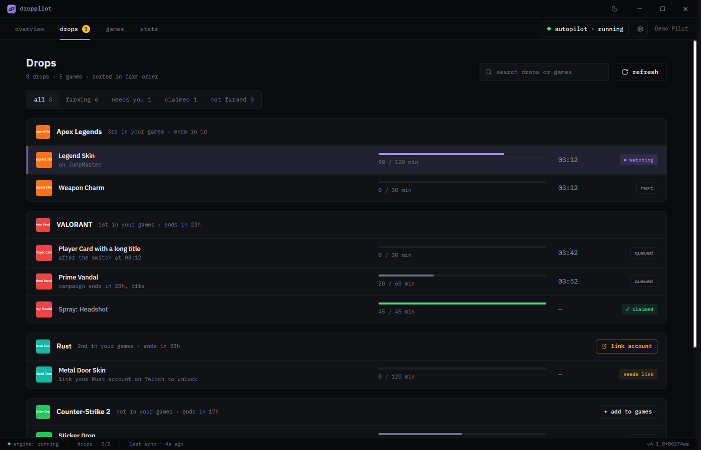
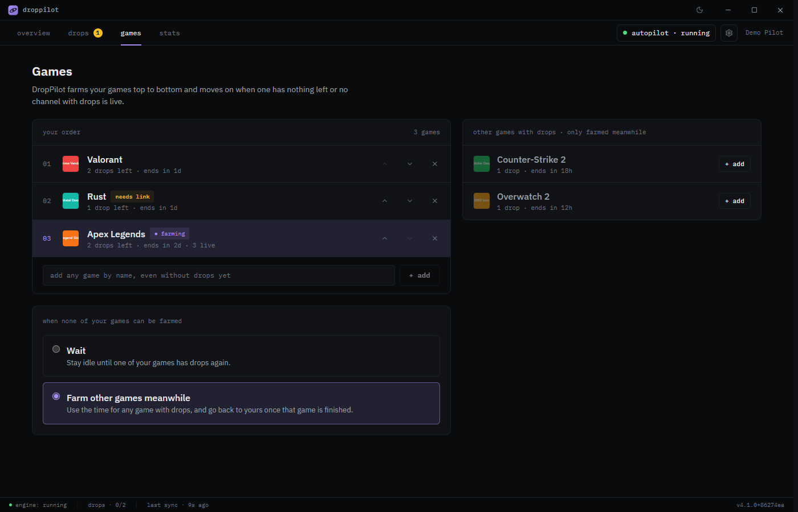
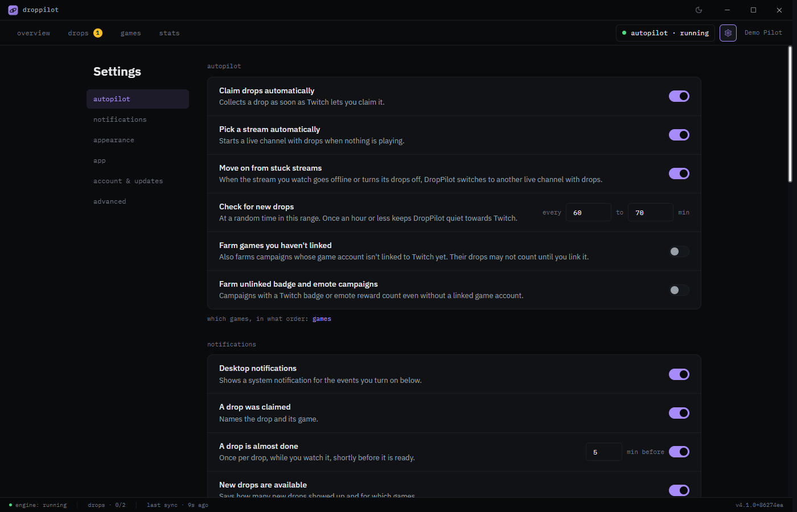

<div align="center">

<picture>
  <source media="(prefers-color-scheme: dark)" srcset="docs/brand/banner-dark.svg" />
  
</picture>

### Collect your Twitch Drops without watching a single stream.

DropPilot runs in the background, watches the right channels for you and claims your rewards.
It also tells you exactly what it's doing and when each drop will be ready.

<p>
<a href="https://github.com/rxm96/droppilot/releases/latest"></a>
&nbsp;
<a href="https://github.com/rxm96/droppilot/releases/latest"></a>
</p>

<p>
<a href="https://github.com/rxm96/droppilot/releases/latest"></a>
<a href="https://github.com/rxm96/droppilot/actions/workflows/build.yml"></a>
<a href="LICENSE"></a>
</p>

<picture>
  <source media="(prefers-color-scheme: light)" srcset="docs/screenshots/overview-light.png" />
  
</picture>

</div>

## How it works

1. **Sign in with Twitch.** DropPilot opens Twitch's own sign-in page in your browser and never sees your password.
2. **Pick your games.** Put the games you want drops for in order. DropPilot farms them from top to bottom.
3. **Leave it running.** Close the window and it keeps going from the tray. Drops are claimed automatically when they're ready.

No video is streamed. DropPilot only sends the same small "minute watched" signal the Twitch player sends, so it barely uses bandwidth or CPU.

## What you get

### Always know what's happening
The overview answers three questions at a glance:
- **What is being farmed right now?**
- **When will it be ready?** Shown as a clock time, not a vague percentage.
- **Do I need to do anything?**

`plan · today` lists every upcoming drop with its ready time and shows when DropPilot will switch to your next game. A **needs you** panel appears only when something actually needs you: a game account to link, a drop to claim, or a sign-in that expired.

### Hands-off, but never out of your control
- **Pause** from the autopilot button on any screen.
- **Switch channel** to pick a specific stream yourself, then hand control back with **auto**.
- **Stuck streams are handled for you.** When a stream goes offline or stops counting progress, DropPilot moves on by itself.

<table>
<tr>
<td width="50%"></td>
<td width="50%"></td>
</tr>
<tr>
<td><strong>Drops.</strong> Every drop from every campaign, grouped by game in the order they get farmed, with progress, ready time and when the campaign ends.</td>
<td><strong>Games.</strong> Your farming order. Add a game, move it up or down, and decide what happens when none of your games can be farmed: wait, or farm other games meanwhile.</td>
</tr>
</table>

### Everything else
- **Auto-claim.** Finished drops are claimed as soon as Twitch allows it.
- **Notifications.** Desktop alerts and optional Discord messages for claimed drops, new drops, drops that are almost done, and errors.
- **Stats.** Drops claimed, hours watched for you, streaks and a calendar of your activity.
- **Light and dark theme.** Pick your own accent color and font pair.
- **English and German.**
- **Demo mode.** Try the whole app with sample data, no Twitch account needed.
- **Updates.** Automatic updates on Windows, with a stable and a preview channel.

<p align="center"></p>

## Install

**Windows.** Download `DropPilot-Setup-x.y.z.exe` from the [latest release](https://github.com/rxm96/droppilot/releases/latest) and run it. The installer isn't code-signed yet, so Windows SmartScreen may warn you. Click **More info → Run anyway**. Updates install themselves from then on.

**macOS (Apple Silicon).** Download the `.dmg` from the [latest release](https://github.com/rxm96/droppilot/releases/latest) and drag DropPilot into Applications. Because the app isn't notarized, the first launch needs **right-click → Open**, or **System Settings → Privacy & Security → Open Anyway**. Automatic updates are Windows-only for now, so download new versions by hand.

## FAQ

<details>
<summary><strong>Is this allowed by Twitch?</strong></summary>

DropPilot automates watching, which Twitch doesn't officially support. It is built to stay quiet:
- It checks your drop inventory about once an hour.
- It listens to the same live events the Twitch website uses.
- It never streams video.

Still, use it at your own risk.
</details>

<details>
<summary><strong>Does my PC have to stay on?</strong></summary>

Yes. DropPilot farms while it's running. You can close the window: it keeps working from the system tray. You can also start it with Windows in Settings.
</details>

<details>
<summary><strong>Why does a drop say "needs link"?</strong></summary>

Some games only give you the reward once your game account is connected to Twitch. DropPilot skips those drops until you link the account, and shows a **link account** button that opens Twitch's connection page.
</details>

<details>
<summary><strong>Why isn't it watching my first game?</strong></summary>

If a game higher on your list gets new drops, DropPilot finishes its current game first, so it doesn't hop back and forth. If you move a game up yourself, it switches right away. The plan on the overview shows what comes next and when. To farm only your own games, choose **Wait** under Games.
</details>

<details>
<summary><strong>Which games does it support?</strong></summary>

It supports any game with an active Twitch Drops campaign. New campaigns show up automatically.
</details>

## For developers

<details>
<summary><strong>Build from source, project layout, contributing</strong></summary>

```bash
npm install
npm run dev      # Vite + Electron with hot reload
```

| Script | Purpose |
| --- | --- |
| `npm run dev` | Run the app with hot reload |
| `npm run build` | Build the renderer (`dist/`) and main + preload (`dist-electron/`) |
| `npm test` | Run the tests (Vitest) |
| `npm run typecheck` | Type-check the renderer and the main/preload configs |
| `npm run lint` / `npm run format` | ESLint / Prettier |

DropPilot is a three-layer Electron app:
- **`src/main`** holds the app lifecycle, IPC, JSON persistence, and the whole Twitch integration (GQL client, live PubSub events, channel tracking, watch pings). All network calls happen here.
- **`src/preload`** is the context bridge that exposes `window.electronAPI`.
- **`src/renderer`** is the React UI. `shared/hooks/app/useAppModel.ts` composes the app state the views render.

The watch engine (auto-select, auto-switch, stall recovery) is described in [`docs/watch-engine.md`](docs/watch-engine.md). Conventions, testing and the release process are in [`CONTRIBUTING.md`](CONTRIBUTING.md), and user-facing changes are tracked in [`CHANGELOG.md`](CHANGELOG.md).

Built with Electron, React 19, Vite 7, TypeScript, Tailwind CSS v4 and Vitest.
</details>

## Acknowledgements

DropPilot's approach to drop mining owes a lot to [**Twitch Drops Miner**](https://github.com/DevilXD/TwitchDropsMiner) by [DevilXD](https://github.com/DevilXD). Several core behaviors are derived from that project:
- watch pings without a video stream
- drop and campaign validation
- automatic channel switching
- PubSub-based progress tracking

Thank you to DevilXD and the Twitch Drops Miner contributors. Twitch Drops Miner is MIT-licensed (© 2024 DevilXD); its license is reproduced in [`THIRD_PARTY_NOTICES.md`](THIRD_PARTY_NOTICES.md).

## License

MIT. See [`LICENSE`](LICENSE).
